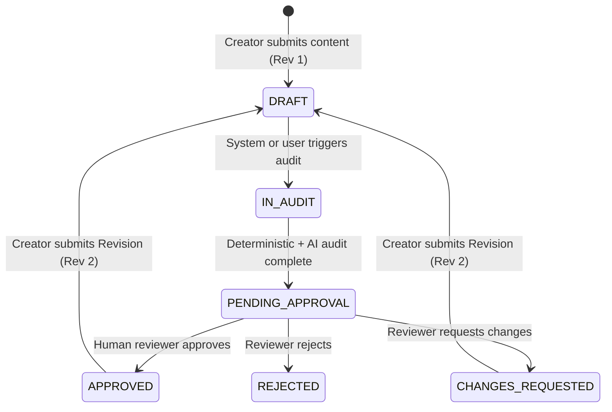

# Inkloom AI — REST API Contract & Specification

Base URLs:
- `/api` (Standard Root)
- `/api/v1` (Versioned Alias)

Both base URLs are fully supported and route to the same underlying services and database models.
All API responses return JSON with standard HTTP status codes (`200 OK`, `201 Created`, `400 Bad Request`, `404 Not Found`, `409 Conflict`, `422 Unprocessable Entity`).
Validation errors return FastAPI standard 422 schemas with field location and error message details.

---

## 1. System Health

### `GET /api/health` (also `GET /api/v1/health` and `GET /health`)
Returns backend operational status, database connectivity, and engine version without exposing internal stack traces or secrets.

- **Auth**: None
- **Response `200 OK`**:
```json
{
  "status": "healthy",
  "version": "1.0.0",
  "timestamp": "2026-10-23T01:00:00Z",
  "database": "connected",
  "environment": "development"
}
```

---

## 2. Guidelines & Brand Rules

### `GET /api/guidelines`
List brand guidelines.

- **Query Parameters**:
  - `organization_id` (optional string): Filter by organization ID.
  - `category` (optional string): Filter by guideline category.
- **Response `200 OK`**:
```json
[
  {
    "id": "gd-corporate-voice-001",
    "organization_id": "org-default-001",
    "name": "Corporate Identity & Voice Guidelines",
    "category": "tone_and_voice",
    "version": "1.0",
    "rules": [
      {
        "id": "rule-term-001",
        "title": "Inkloom AI Canonical Casing",
        "description": "Always write Inkloom AI with proper capitalization.",
        "category": "terminology",
        "severity": "high",
        "prohibited_phrases": ["inkloom ai", "Inkloom ai", "inkloom AI", "Inkloom"],
        "required_phrases": ["Inkloom AI"]
      }
    ],
    "is_active": true
  }
]
```

### `POST /api/guidelines`
Create a new brand guideline.

- **Request Body**:
```json
{
  "organization_id": "org-default-001",
  "name": "Sustainability & Eco Communication Standards",
  "category": "factual_accuracy",
  "version": "1.0",
  "rules": [
    {
      "title": "Carbon Neutrality Claims",
      "description": "Any claim of carbon neutrality must cite third-party ISO verification.",
      "category": "factual_accuracy",
      "severity": "critical",
      "prohibited_phrases": ["100% green", "zero footprint"]
    }
  ],
  "is_active": true
}
```
- **Response `201 Created`**: Returns created `BrandGuidelineResponse`.

### `GET /api/guidelines/{guideline_id}`
Retrieve a guideline by ID including all active nested rules.

- **Response `200 OK`**: Guideline object.
- **Response `404 Not Found`**: `{"detail": "Guideline not found: {guideline_id}"}`.

### `POST /api/guidelines/{guideline_id}/rules`
Append a new brand rule to an existing guideline.

- **Request Body**:
```json
{
  "title": "Banned Colloquialisms",
  "description": "Avoid hyperbole and slang in official marketing.",
  "category": "tone",
  "severity": "medium",
  "prohibited_phrases": ["super pumped", "game changer", "revolutionary"]
}
```
- **Response `201 Created`**: Returns created `BrandRuleSchema`.

---

## 3. Verified Facts & Knowledge Sources

### `GET /api/facts`
List verified enterprise claims and evidentiary knowledge sources.

- **Query Parameters**:
  - `organization_id` (optional string): Filter by organization.
  - `status` (optional string): Filter by verification status (`verified`, `pending`, `disputed`).
- **Response `200 OK`**:
```json
[
  {
    "id": "fact-001",
    "organization_id": "org-default-001",
    "claim_text": "Inkloom AI reduces brand review turnaround times by 68%.",
    "source_url": "https://inkloom.ai/research/whitepaper-2026.pdf",
    "confidence_score": 0.99,
    "status": "verified",
    "created_at": "2026-10-23T01:00:00Z"
  }
]
```

### `POST /api/facts`
Register a newly verified corporate fact or audit evidence document.

- **Request Body**:
```json
{
  "organization_id": "org-default-001",
  "claim_text": "Inkloom AI processes over 10,000 marketing assets monthly.",
  "source_url": "https://internal.inkloom.ai/metrics/q3.pdf",
  "confidence_score": 0.95,
  "status": "verified"
}
```
- **Response `201 Created`**: Returns created `VerifiedFactResponse`.

---

## 4. Content Submissions, Versioning & History

### `POST /api/content` (also `POST /api/v1/content/submit`)
Submit new marketing copy or content item for brand governance. Automatically creates Version 1 (`current_revision: 1`) in `DRAFT` status.

- **Request Body**:
```json
{
  "title": "Q4 Enterprise Launch Announcement",
  "content_type": "text",
  "raw_text": "Inkloom AI is revolutionary and changes how enterprise marketing teams govern assets.",
  "organization_id": "org-default-001",
  "author_id": "author-user-01"
}
```
- **Response `201 Created`**:
```json
{
  "content_id": "9a8b7c6d-5e4f-3a2b-1c0d-e9f8a7b6c5d4",
  "current_revision": 1,
  "status": "draft",
  "title": "Q4 Enterprise Launch Announcement",
  "created_at": "2026-10-23T01:00:00Z"
}
```

### `GET /api/content`
List content submissions with optional pagination and status filtering.

- **Query Parameters**: `skip` (default 0), `limit` (default 50), `status` (optional), `organization_id` (optional).
- **Response `200 OK`**: Array of content submission summaries.

### `GET /api/content/{content_id}`
Retrieve complete content metadata, current revision, text, and workflow status.

- **Response `200 OK`**:
```json
{
  "content_id": "9a8b7c6d-5e4f-3a2b-1c0d-e9f8a7b6c5d4",
  "title": "Q4 Enterprise Launch Announcement",
  "status": "pending_approval",
  "current_revision": 1,
  "raw_text": "Inkloom AI is revolutionary...",
  "organization_id": "org-default-001",
  "created_at": "2026-10-23T01:00:00Z",
  "updated_at": "2026-10-23T01:05:00Z"
}
```

### `POST /api/content/{content_id}/revisions`
Submit a revision to existing content.
**Governance Rule**: This creates an immutable new revision (e.g. Revision 2) and resets the content workflow status back to `DRAFT`. Any prior approvals on older revisions DO NOT apply to the new revision.

- **Request Body**:
```json
{
  "raw_text": "Inkloom AI is an enterprise-grade platform for brand governance.",
  "change_summary": "Removed hyperbole 'revolutionary' and replaced with accurate brand voice."
}
```
- **Response `201 Created`**:
```json
{
  "content_id": "9a8b7c6d-5e4f-3a2b-1c0d-e9f8a7b6c5d4",
  "current_revision": 2,
  "status": "draft",
  "title": "Q4 Enterprise Launch Announcement",
  "created_at": "2026-10-23T01:10:00Z"
}
```

### `GET /api/content/{content_id}/history`
Retrieve complete chronological revision history for a content item.

- **Response `200 OK`**:
```json
{
  "content_id": "9a8b7c6d-5e4f-3a2b-1c0d-e9f8a7b6c5d4",
  "title": "Q4 Enterprise Launch Announcement",
  "current_revision": 2,
  "status": "draft",
  "versions": [
    {
      "version_number": 1,
      "text": "Inkloom AI is revolutionary...",
      "created_at": "2026-10-23T01:00:00Z"
    },
    {
      "version_number": 2,
      "text": "Inkloom AI is an enterprise-grade platform...",
      "created_at": "2026-10-23T01:10:00Z"
    }
  ]
}
```

---

## 5. Audit Execution & Section 9 Finding Schema

### `POST /api/content/{content_id}/audit` (also `POST /api/audits/run`)
Trigger an automated brand governance audit on a specific revision of content.
If `revision_id` is omitted, defaults to the content's current latest revision.

- **Request Body**:
```json
{
  "revision_id": 1,
  "guideline_ids": ["gd-corporate-voice-001"]
}
```
- **Response `200 OK`**: Structured `AuditResultResponse`.

### `GET /api/audits/{audit_id}`
Retrieve historical audit results with full structured findings.

- **Response `200 OK`**:
```json
{
  "audit_id": "audit-9a8b7c6d-v1-run",
  "content_id": "9a8b7c6d-5e4f-3a2b-1c0d-e9f8a7b6c5d4",
  "content_version": 1,
  "guideline_id": "gd-corporate-voice-001",
  "guideline_version": "1.0",
  "overall_score": 75.0,
  "status": "completed",
  "findings": [
    {
      "id": "finding-001-9a8b7c6d",
      "category": "tone",
      "severity": "medium",
      "original_text": "revolutionary",
      "explanation": "Flagged term 'revolutionary' violates brand guidelines on hyperbole.",
      "guideline_id": "gd-corporate-voice-001",
      "evidence_status": "contradicted",
      "suggestion": "Replace with specific capability description."
    }
  ],
  "created_at": "2026-10-23T01:05:00Z"
}
```

### Audit Finding Specification (Section 9 Requirement)
Each finding in `findings[]` strictly validates against these enumerations:

- **Allowed Categories**:
  - `tone`
  - `terminology`
  - `factual_accuracy`
  - `unsupported_claim`
  - `visual_consistency`
  - `accessibility`
- **Allowed Severity Levels**:
  - `low`
  - `medium`
  - `high`
  - `critical`
- **Allowed Evidence Statuses**:
  - `supported`
  - `contradicted`
  - `unverified`
  - `unavailable`

---

## 6. Review Workflow & Human Approvals

### `POST /api/reviews/{review_id}/decision` (also `POST /api/reviews/decision`)
Record a formal human review decision on content.

- **Path Parameter**: `review_id` (UUID or content ID)
- **Request Body**:
```json
{
  "content_id": "9a8b7c6d-5e4f-3a2b-1c0d-e9f8a7b6c5d4",
  "revision_id": 1,
  "action": "approved",
  "comments": "Copy is certified compliant with brand voice.",
  "reviewer_id": "reviewer-user-42"
}
```
- **Allowed Actions**:
  - `approved` (or `approve`) -> Content status becomes `APPROVED`
  - `changes_requested` (or `request_changes`) -> Content status becomes `CHANGES_REQUESTED`
  - `rejected` (or `reject`) -> Content status becomes `REJECTED`
- **Response `200 OK`**:
```json
{
  "review_id": "dec-a1b2c3d4-e5f6",
  "content_id": "9a8b7c6d-5e4f-3a2b-1c0d-e9f8a7b6c5d4",
  "revision_id": 1,
  "action": "approved",
  "status": "approved",
  "reviewer_id": "reviewer-user-42",
  "comments": "Copy is certified compliant with brand voice.",
  "created_at": "2026-10-23T01:12:00Z"
}
```

### `GET /api/reviews`
List all review decisions across the organization.

- **Query Parameters**: `content_id` (optional), `limit` (default 50).
- **Response `200 OK`**: Array of `ReviewDecisionResponse`.

### `GET /api/content/{content_id}/reviews`
Retrieve the complete review decision history for a specific content item.

- **Response `200 OK`**: Array of `ReviewDecisionResponse`.

---

## 7. Analytics & Governance Metrics

### `GET /api/analytics` (also `GET /api/v1/analytics/summary`)
Retrieve live calculated brand governance metrics aggregated directly from stored database records.

- **Response `200 OK`**:
```json
{
  "total_content_items": 14,
  "total_audits": 28,
  "approved_count": 8,
  "changes_requested_count": 4,
  "rejected_count": 2,
  "findings_by_severity": {
    "critical": 3,
    "high": 12,
    "medium": 24,
    "low": 8
  },
  "compliance_rate": 78.5
}
```

---

## 8. Governance Workflow State Rules



1. **AI Never Approves**: Zero audit findings moves content to `PENDING_APPROVAL`. Only authorized human reviewers can grant `APPROVED` status.
2. **Revision Invalidation**: Any revision to approved content immediately transitions the item back to `DRAFT`. Approvals are strictly version-scoped.
3. **Audit Trail**: Every revision, audit execution, and review decision generates an immutable `AuditEventModel` record for compliance tracing.

