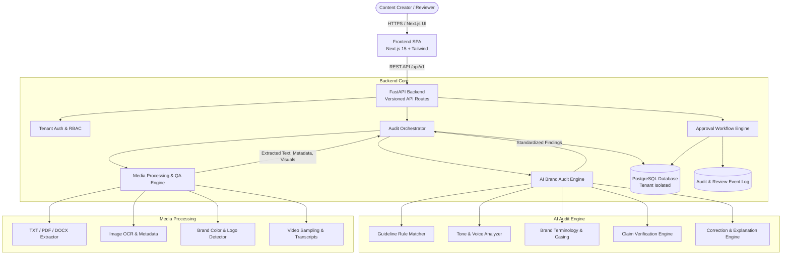

# Inkloom AI — System Architecture & Design Specification

## 1. System Overview

**Inkloom AI** is an enterprise-grade AI brand governance platform designed to ensure all marketing, sales, and corporate assets strictly adhere to authorized brand guidelines, terminology standards, factual claims, visual identities, and compliance rules.

The system is structured as a modular, multi-tenant monolith with cleanly separated services designed for high velocity team development and future microservice decomposition.

---

## 2. High-Level Data Flow

1. **Submission**: A content creator submits text copy, documents (PDF, DOCX), or visual assets via the Next.js UI.
2. **Tenant Scoping & Storage**: The backend validates the user's workspace membership and saves the submission as `ContentSubmission` (revision 1) in `draft` state.
3. **Extraction & Pre-processing**:
   - `MediaAuditService` safely inspects file signatures, sanitizes paths, and extracts plain text chunks with page numbers or timestamps.
   - For images, visual brand checks inspect color palettes and logo clearspace.
4. **AI Audit Orchestration**:
   - `AuditOrchestrator` fetches active brand guidelines scoped to the organization.
   - Extracted text and visual metrics are sent to `AIAuditEngine`.
   - Guideline retrieval retrieves relevant rules.
   - Tone, terminology, and claim verification run deterministically or via LLM adapters.
   - All findings are validated against `contracts/audit-result.schema.json`.
5. **Workflow Transition**:
   - If critical or high violations exist, the workflow transitions to `changes_requested` or `pending_approval`.
   - **Crucial Rule**: The AI engine *never* transitions state to `approved`. Only an authorized human reviewer can grant publication approval.
6. **Review Decision**:
   - A brand reviewer logs in, views the findings with evidence and suggested corrections, and submits an `approve`, `reject`, or `request_changes` decision with mandatory comments and timestamped audit logging.

---

## 3. Core Architectural Boundaries

To allow four contributors to build independently without git friction:

| Subsystem | Folder Path | Responsibility | Primary Interfaces |
| :--- | :--- | :--- | :--- |
| **Backend & DB** | `backend/app/api/`, `models/`, `schemas/`, `database/`, `workflow/` | API routing, DB persistence, tenant isolation, RBAC, workflow validation | REST endpoints, SQLAlchemy models, Pydantic schemas |
| **Frontend** | `frontend/app/`, `components/`, `services/`, `types/` | Responsive SaaS UI, mock service layer, API client, dashboards | React 19 / Next.js 15, `AuditResult` contract |
| **AI Audit Engine** | `backend/app/services/ai_audit/` | Rule-based and model-based compliance analysis, claim checking | `AIAuditEngine.run_audit(content, guidelines)` |
| **Media & QA** | `backend/app/services/media_audit/`, `backend/tests/media/` | File extraction, OCR, video frame sampling, visual analysis, fixtures | `MediaExtractor.extract(file_path, mime_type)` |

---

## 4. Shared Contract

All components speak through a versioned JSON schema located in:
`contracts/audit-result.schema.json`

This ensures that the AI Engine output, database persistence, and frontend visualization always stay strictly aligned.
